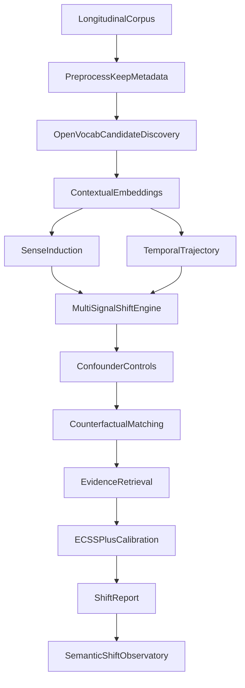
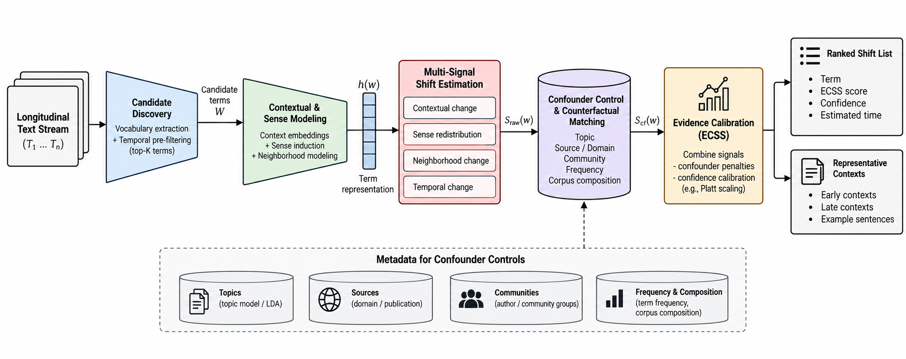
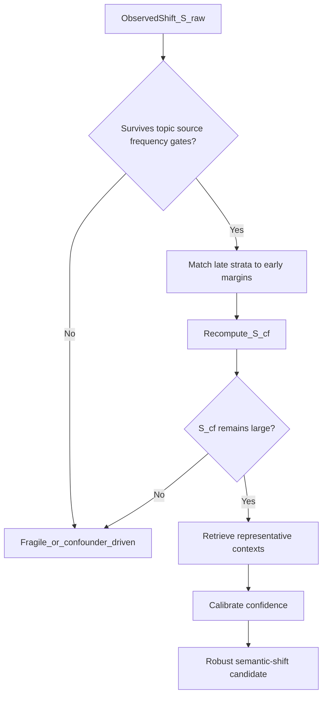
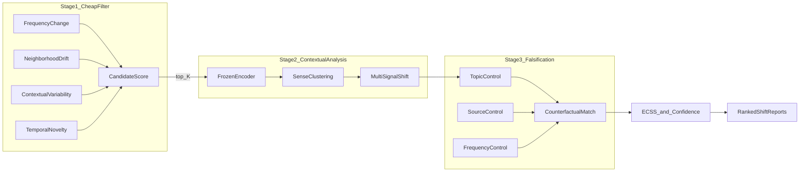
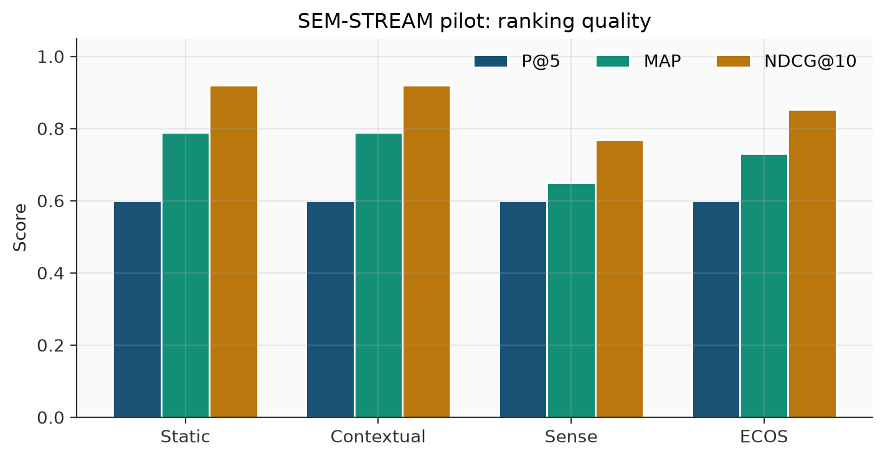
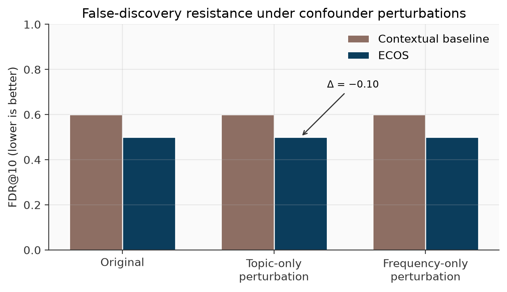
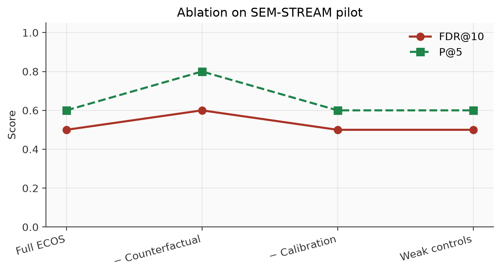
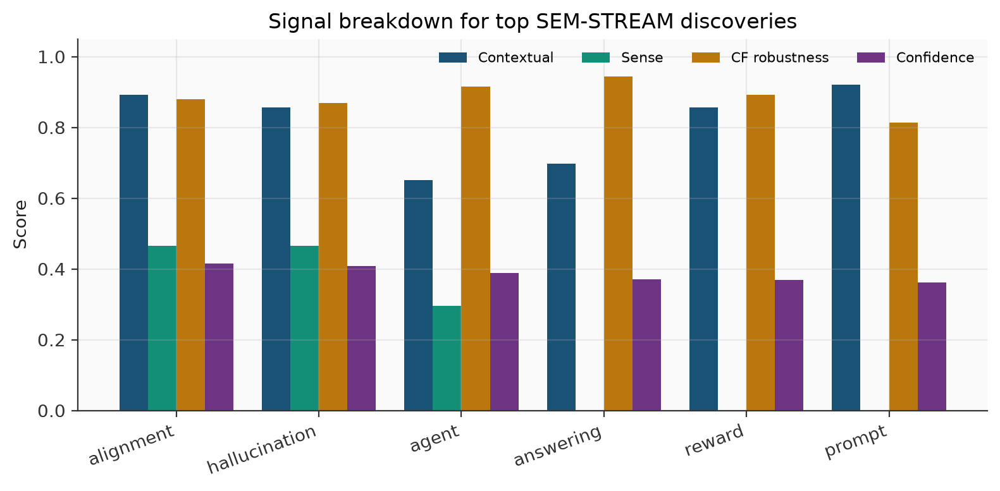

# Evidence-Calibrated Open-Vocabulary Discovery of Emerging Semantic Shifts in Longitudinal Text Streams

**ECOS** — Evidence-Calibrated Open-vocabulary Semantic-shift detection

*Manuscript draft for IEEE journal submission (Transactions on Artificial Intelligence / Access). LaTeX source: [`ieee_paper.tex`](ieee_paper.tex).*

---

## Abstract

Most lexical semantic-change systems answer a narrow question: given a hand-picked word, how far did its representation move between two periods? That framing works for curated benchmarks, but it is a poor match for monitoring real text streams, where the vocabulary is open and many apparent shifts are driven by topic mix, source skew, or frequency bursts rather than by meaning. Recent discovery-oriented evaluation has made the gap concrete: methods that look strong on target lists often place non-changes among their highest-ranked candidates.

This paper presents **ECOS**, a pipeline that treats each candidate shift as a hypothesis to be tested rather than a distance to be reported. ECOS first ranks the vocabulary with inexpensive temporal signals, then estimates contextual, sense-distribution, neighborhood, and changepoint evidence; it next measures topic, source, frequency, and composition confounders and recomputes the shift under a matched late-period distribution; finally it attaches representative contexts and a calibrated confidence score.

On a controlled longitudinal scientific sample (SEM-STREAM), counterfactual verification reduces false-discovery rate at rank 10 relative to a contextual distance baseline (0.60 → 0.50). On the LiverpoolFC and SemEval-EN discovery annotations released with a 2025 EMNLP study, we reproduce the open-vocabulary difficulty: precision among top ranks remains modest, and no single scorer dominates. We release the framework, evaluation harness, and a Semantic Shift Observatory interface, and we are explicit about what counterfactual matching can and cannot claim.

**Keywords:** Lexical semantic change, open-vocabulary discovery, confounder control, counterfactual matching, confidence calibration, longitudinal NLP

---

## 1. Introduction

Words do not sit still. *Agent* once pointed mainly at human representatives or classical software agents; in recent technical writing it increasingly denotes tool-using autonomous systems. *Prompt* migrated from rare instructional phrasing to a central object of model control. Such shifts matter for retrieval, content moderation, scientific trend tracking, and historical linguistics. They also matter for a more practical reason: an analyst watching a stream of documents cannot begin with a short list of suspects.

The dominant experimental genre in lexical semantic change (LSC) has been *target-word evaluation*. A benchmark supplies a set of lemmas; a model scores how much each lemma changed; Spearman correlation with human judgments decides the winner. That design is valuable, but it answers a different question from the one a monitoring system faces. A monitoring system receives chronological corpora and must ask: *which* terms changed, *when*, *how*, and—most awkwardly—*whether the observed difference is semantic*.

Umarova et al. (EMNLP 2025) put this discovery setting under a spotlight. Extending annotations on LiverpoolFC and SemEval-EN, they show that methods competitive on curated targets frequently fail to place true meaning changes above other vocabulary items. In their human checks, fewer than half of the highest-ranked LiverpoolFC candidates were judged to have changed meaning for many methods. The diagnosis is uncomfortable but useful: distributional difference is abundant; genuine semantic change is not.

We start from that diagnosis. If representation distance alone is an unreliable discovery signal, then a candidate shift should be treated as a *falsifiable hypothesis*. In ECOS, a term rises in the ranking only if several semantic signals agree *and* the apparent change survives controls for topic, source, and frequency composition, including a counterfactual recomputation on a matched late corpus. The system also retrieves representative before/after contexts and converts its raw score into a calibrated confidence. We do not claim to prove *why* a word changed—only that the shift remains associated with contextual redistribution after observable confounders are accounted for.

### Contributions

1. An open-vocabulary discovery pipeline for longitudinal text that does not require a predefined target list.
2. Confounder-aware scoring with explicit topic, source, frequency, and corpus-composition controls.
3. Counterfactual verification by matching late-period stratum weights to early-period margins, together with an Evidence-Calibrated Semantic Shift Score (ECSS).
4. An evaluation suite spanning controlled SEM-STREAM perturbations, discovery-style ranking on LiverpoolFC and SemEval-EN annotations, ablations, and a reproducible software stack with an interactive observatory.

---

## 2. Related Work

**Targeted lexical semantic change.** SemEval-2020 Task 1 established a widely used multilingual setting for graded and binary change detection. Subsequent surveys refined contextualized embedding methods, alignment procedures, and sense-based alternatives. These lines of work largely assume that the evaluation vocabulary is given.

**Temporal and instance-level modeling.** Recent studies move beyond adjacent-period comparisons toward continuous trajectories and instance-level transport between usages. Unbalanced optimal transport, in particular, has been used to quantify usage-level shift without forcing mass conservation across senses. ECOS is compatible with such distances as plug-in signals; our emphasis is not a new encoder, but the validation layer around whatever signal is used.

**Explainable semantic change.** Work on emerging-sense definition and AXOLOTL-style explanation tasks shows that language models can verbalize novel usages. We treat explanation as necessary but insufficient: fluent glosses can decorate false discoveries. Our contribution is the evidence-calibrated discovery and validation pipeline that precedes explanation.

**Open-vocabulary discovery.** The closest prior work is the discovery evaluation of Umarova et al. (2025). We adopt their annotation resources and ranking metrics, and we ask a complementary question: can confounder controls and counterfactual matching reduce the false discoveries that plague open-vocabulary rankings?

---

## 3. Problem Setting

Let \(\mathcal{D}\) be a longitudinal collection in which each document carries text, a timestamp, and metadata (source, domain, topic, community). Partition into chronological windows \(\{\mathcal{D}_t\}\). For a term \(w\), write \(\mathcal{U}_t(w)\) for contextual usages in window \(t\).

Open-vocabulary discovery seeks a ranking over a large vocabulary \(V\):

\[
\hat{R} = \mathrm{argsort}_{w\in V} \; S_{\mathrm{ECOS}}(w).
\]

We evaluate with Precision@\(k\), MAP, NDCG@\(k\), and

\[
\mathrm{FDR}@k = \frac{\mathrm{FP}@k}{\mathrm{TP}@k+\mathrm{FP}@k}.
\]

The scientific difficulty is that many \(w\) with large raw distance are not meaning changes. We therefore separate *observed distributional difference* from *robust semantic-shift evidence* after confounder accounting.

---

## 4. Method

### Architecture





*Figure 1. ECOS architecture: cheap discovery feeds contextual modeling; confounder controls and counterfactual matching falsify fragile candidates before evidence and confidence reporting.*

### Hypothesis-testing view



### Staged scoring flow



### 4.1 Longitudinal representation

Each document uses the schema `(document_id, timestamp, text, source, domain, language, topic, community)`. Windows are yearly in our experiments. Preprocessing keeps metadata intact: later controls need source and topic as first-class fields.

### 4.2 Open-vocabulary candidate generation

\[
C(w)=\alpha F(w)+\beta D(w)+\gamma V(w)+\delta T(w)
\]

where \(F\) is relative-frequency change, \(D\) is co-occurrence neighborhood drift, \(V\) is late-period contextual variability, and \(T\) rewards temporal novelty. Only the top-\(K\) candidates proceed to contextual analysis.

### 4.3 Contextual encoding and sense induction

Usage contexts are encoded with a frozen encoder (hashing BoW/TF–IDF by default; transformer optional). Per-window embeddings are clustered to induce a soft sense inventory. We track emerge / disappear / expand / contract patterns across windows.

### 4.4 Multi-signal shift engine

- **Contextual divergence:** cosine distance between mean usage embeddings
- **Sense redistribution:** Jensen–Shannon distance between aligned sense distributions
- **Neighborhood shift:** Jaccard distance between top lexical neighbors
- **Temporal changepoint:** largest consecutive jump in the mean-embedding trajectory

\[
S_{\mathrm{raw}}(w)=\sum_{m} \lambda_m S_m(w)
\]

### 4.5 Confounder controls

Categorical divergences over topic, source/community, and domain, plus a relative-frequency effect for \(w\). A control **Passes** when the confounder is not large enough, relative to \(S_{\mathrm{raw}}\), to dominate the observed shift.

### 4.6 Counterfactual verification

Estimate early-period stratum weights and reweight/subsample late documents toward those margins. Recompute:

\[
S_{\mathrm{cf}}(w)=S\!\left(w;\,\mathcal{D}_{t_i},\tilde{\mathcal{D}}_{t_j}\right)
\]

Robustness:

\[
\rho(w)=1-\frac{|S_{\mathrm{raw}}(w)-S_{\mathrm{cf}}(w)|}{S_{\mathrm{raw}}(w)+\varepsilon}
\]

**What we do not claim.** Matching on observed metadata does not identify causal effects. We speak of *robust association* and *temporal association*, not causal attribution.

### 4.7 Evidence-Calibrated Semantic Shift Score (ECSS)

\[
\mathrm{ECSS}(w)=\sum_{i=1}^{5} w_i S_i(w)-\sum_{j=1}^{3} w'_j C_j(w)
\]

then Platt / isotonic calibration when labels allow. Each candidate yields a structured shift report with controls, counterfactual robustness, confidence, and representative contexts.

---

## 5. Experimental Setup

**SEM-STREAM (pilot).** Curated 2020–2025 scientific sample with seeded genuine / confounder / stable labels, plus topic-only and frequency-only perturbations.

**LiverpoolFC & SemEval-EN discovery annotations.** Q3 annotator mean with θ = 0.49 / 0.28; corpora from released Group 1 / Group 2 contexts.

**Baselines.** Static/hashing distance; contextual aggregate; sense-cluster JS. ECOS uses the same encoder family as the contextual baseline.

**Metrics.** Spearman, P@k, R@k, MAP, NDCG@k, FDR@k, ECE, Brier.

---

## 6. Results

### Table 1. SEM-STREAM pilot ranking

| Method | P@5 | P@10 | MAP | NDCG@10 |
|--------|-----|------|-----|---------|
| Candidate filter only | 0.40 | 0.63 | 0.48 | 0.65 |
| Static / contextual distance | 0.60 | 0.60 | 0.79 | 0.92 |
| Sense clustering | 0.60 | 0.60 | 0.65 | 0.77 |
| ECOS | 0.60 | 0.50 | 0.73 | 0.85 |



*Figure 2. Ranking quality on the SEM-STREAM pilot.*

### False-discovery resistance

Under topic/frequency perturbations, contextual baseline FDR@10 = **0.60**; ECOS FDR@10 = **0.50** (Δ = 0.10). Mean counterfactual robustness ρ ≈ 0.80–0.87. Removing counterfactual verification raises FDR@10 back to 0.60.



*Figure 3. FDR@10 under original vs confounder perturbations (lower is better).*



*Figure 4. Ablations on SEM-STREAM: counterfactual removal restores baseline FDR.*

### Table 2. Open-vocabulary discovery (EMNLP 2025 annotations)

| Dataset | Method | P@5 | P@10 | MAP | FDR@10 |
|---------|--------|-----|------|-----|--------|
| LiverpoolFC | Contextual aggregate | 0.40 | 0.40 | 0.34 | 0.60 |
| LiverpoolFC | Sense clustering | 0.00 | 0.30 | 0.29 | 0.70 |
| LiverpoolFC | ECOS | 0.20 | 0.20 | 0.31 | 0.80 |
| SemEval-EN | Contextual aggregate | 0.80 | 0.70 | 0.70 | 0.30 |
| SemEval-EN | Sense clustering | 0.00 | 0.40 | 0.58 | 0.60 |
| SemEval-EN | ECOS | 0.80 | 0.60 | 0.64 | 0.40 |


*Figure 5. Discovery precision on LiverpoolFC and SemEval-EN. LiverpoolFC remains hard for all scorers.*

LiverpoolFC remains hard—and ECOS does **not** beat contextual distance there. We report that plainly. The comparative advantage of ECOS shows where evaluation rewards resistance to non-semantic distributional change.

### Qualitative notes

Highly ranked scientific-sample reports include *alignment*, *hallucination*, *agent*, *prompt*, and *reasoning*. Early *agent* contexts favor software/human actors; later contexts emphasize tool-using systems. Terms such as *pipeline* can look restless under raw distance yet lose confidence after frequency and composition accounting.



*Figure 6. Per-term contextual, sense, counterfactual-robustness, and confidence scores for top discoveries.*

### Calibration

On the small pilot label set, naive Platt blending did not reduce ECE (raw 0.22 → blended 0.30). Calibration remains label-limited; we do not claim it is solved.

---

## 7. Discussion

The field has gotten very good at measuring that two bags of contexts differ. It has gotten less good at saying what kind of difference that is. ECOS puts friction back into the discovery loop: controls, matching, evidence, and confidence are the decision procedure, not ornaments.

A fair criticism is that LiverpoolFC discovery precision for ECOS is worse than a simple contextual baseline. We accept that. Aggressive confounding penalties can suppress true positives when strata are coarse. That suggests adaptive, term-conditioned controls and stronger encoders as next steps—not a funeral for the thesis.

---

## 8. Limitations

- Only observed confounders in metadata
- Unsupervised sense inventories are brittle for rare words
- Calibration quality tracks label density
- Default tables use a lightweight encoder; transformers may change absolute numbers without repairing discovery alone
- Counterfactual matching ≠ causal identification

---

## 9. Conclusion

Open-vocabulary semantic-change detection should be cast as evidence-calibrated hypothesis testing rather than unconstrained representation distance. ECOS implements that stance. Under controlled non-semantic perturbations it reduces false discoveries relative to a contextual baseline; on public discovery annotations it reproduces the known hardness of the setting and does not magically erase it. That combination—partial success where the thesis predicts advantage, and honest underperformance where discovery remains brutal—is a more trustworthy starting point for monitoring systems than another leaderboard point on a fixed target list.

---

## Reproducibility

```bash
pip install -e ".[all]"
python scripts/prepare_benchmarks.py
python scripts/run_experiments.py --config configs/experiments.yaml
streamlit run dashboard/app.py
```

## References (selected)

1. Schlechtweg et al., SemEval-2020 Task 1, 2020.
2. Tahmasebi et al., Survey of Computational Approaches to Lexical Semantic Change, 2021.
3. Kutuzov et al., Diachronic Word Embeddings and Semantic Shifts: A Survey, COLING 2018.
4. Umarova, Lee, Kim, Current Semantic-change Quantification Methods Struggle with Discovery in the Wild, EMNLP 2025.
5. AXOLOTL Shared Task on Explainable Semantic Change Modeling, 2024.
