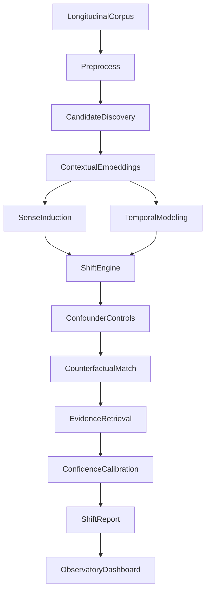
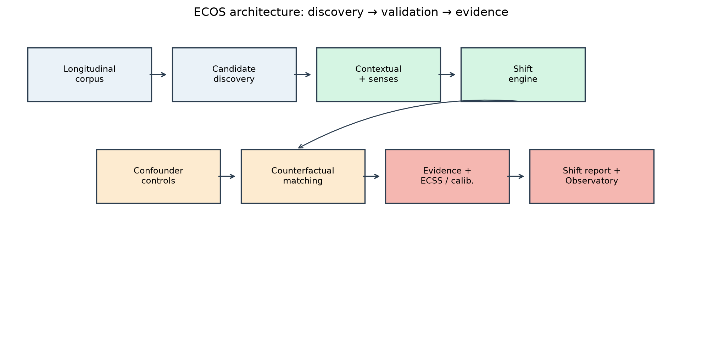

# ECOS — Evidence-Calibrated Open-Vocabulary Semantic Shift Detection

An AI framework that discovers emerging changes in word meaning across time, distinguishes genuine semantic evolution from topic/source/frequency-driven distributional changes, validates discoveries through counterfactual testing, and produces calibrated textual evidence for each detected shift.

> **Core novelty:** semantic change is treated as a hypothesis that must survive evidence-based counterfactual validation, not merely as a large change in representation space.

## Quick start

```bash
python -m venv .venv
source .venv/bin/activate
pip install -e ".[all]"

# Prepare EMNLP 2025 discovery labels + LiverpoolFC subsample
python scripts/prepare_benchmarks.py

# Run end-to-end demo on the bundled sample corpus
python scripts/run_pipeline.py --config configs/demo.yaml

# Run evaluation suite (includes LiverpoolFC / SemEval-EN discovery)
python scripts/run_experiments.py --config configs/experiments.yaml

# Launch Semantic Shift Observatory
streamlit run dashboard/app.py
```

## Architecture





Regenerate plots after experiments:

```bash
python scripts/run_experiments.py --config configs/experiments.yaml
python scripts/generate_figures.py
```

## Package layout

| Path | Role |
|------|------|
| `ecos/` | Core library (data, shift, controls, calibration, eval) |
| `configs/` | Corpus / model / experiment YAML |
| `scripts/` | Download, pipeline, experiments, figure generation |
| `dashboard/` | Streamlit observatory |
| `paper/` | IEEE manuscript + figures |
| `docs/diagrams/` | Mermaid architecture sources |
| `data/sample/` | Tiny demo corpus for offline runs |
| `tests/` | Unit / integration tests |

## Research positioning

Existing lexical semantic-change systems often report distributional differences. Open-vocabulary discovery produces many false positives (EMNLP 2025). ECOS asks: **is this change actually semantic after controlling for observable confounders?**
